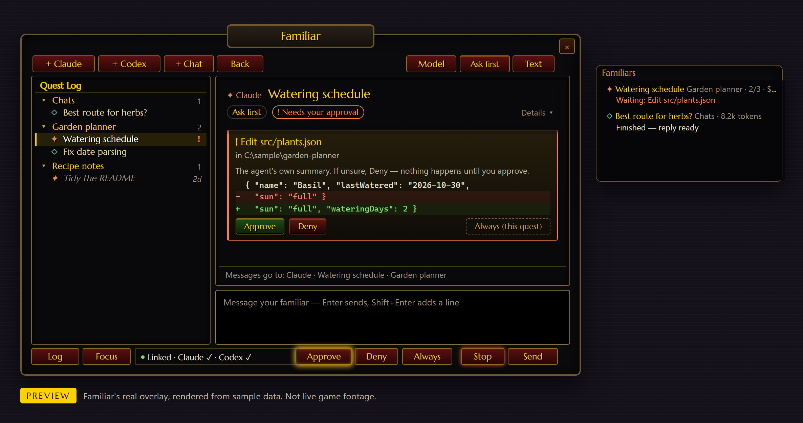
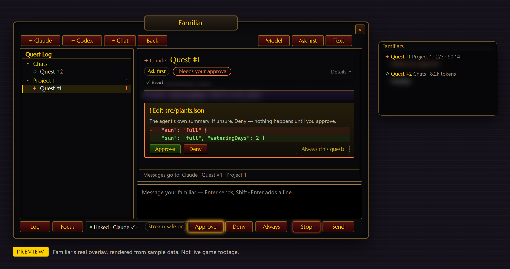

# Familiar

A quest log for your coding agents, inside World of Warcraft: Forever.



*Rendered from the real overlay with sample data.*


Familiar lets you talk to your own coding agents (Claude Code, Codex, and other
[Agent Client Protocol](https://agentclientprotocol.com) agents) from a quest log inside WoW:
Forever. You start a quest in a project folder, keep playing while the agent works, and approve
what it wants to do with a key you choose. It never presses keys or clicks in the game, never reads
game memory, never talks to Blizzard's servers and never sends anything to the Familiar author.

*Original art for Familiar.*

> **Beta.** Tested on a small number of PCs. Expect rough edges and please
> [report bugs](https://github.com/Zeezy3z/familiar/issues/new/choose).

You need Windows 11, WoW: Forever in **Windowed** or **Windowed (Fullscreen)** mode, and Claude Code
or Codex installed and signed in on the same PC ([Signing in](#signing-in)).

## Install

1. Open the [Releases page](https://github.com/Zeezy3z/familiar/releases). If the newest release
   lists **`Familiar-Setup-<version>.exe`**, run it (it installs for your user, no administrator
   rights) and go to step 3. Otherwise download **`FamiliarApp-v<version>-windows.zip`**,
   right-click it → **Properties** → **Unblock**, and extract it so that `Run Familiar.cmd` ends up
   in `C:\Familiar` (not in OneDrive or a network drive).
2. Double-click **`Run Familiar.cmd`**. If Windows says "Windows protected your PC", choose
   **More info → Run anyway**. The first run downloads Claude Code (about 112 MB). Familiar's
   control panel and a tray icon appear.
3. **Restart World of Warcraft.** At character select open **AddOns**, tick **Familiar** and
   **Familiar Sync**, log in and type `/fam`. The control panel's status line says **All set**.

Familiar does not start with Windows unless you tick **Start with Windows** at the bottom of the
control panel.

## Your first quest

Type `/fam` or click the owl on the minimap. The first time, the log holds a practice quest, *A
Familiar Face*, that walks you through a request without running anything.

1. Click **+ Quest**, pick a familiar (when you use more than one), then pick a zone: a project
   folder. Typing a folder path works too, but only for a folder under one you added in the control
   panel or one Familiar already lists.
2. Type what you want and press Enter. The familiar works while you play.
3. A **!** on a quest means it **Needs you**; **Reply ready** means it answered. Open the quest to
   read it.

**+ Chat** asks a game question with no project folder (see [Chats](#chats)).

## Approving

When a familiar wants to change a file or run a command, its request is pinned at the bottom of
the quest on the Glass (the layer Familiar draws over the game). Nothing happens until you decide.

* **Approve:** press your **Approve key**. Set it up once: in WoW, bind **Approve the pending
  request** (Esc → Options → Keybindings → AddOns → Familiar), then in the control panel go to
  **Safety → Approve key → Set key…** and press the same key. The key works only on a request that
  has been on screen, unchanged, for a moment and that you have scrolled to the end of.
* **Approve by click:** off by default. **Safety → Approve by mouse click** lets you click Approve
  on the card instead. It is weaker: something else in the game could put a request where you are
  about to click.
* **Deny** and **Stop** always work: the bottom-bar buttons, their keybinds, `/fam deny`, `/fam stop`.
* **Always** and **modes** are set only in the control panel. **Requests waiting** at the top of the
  panel lists pending requests and offers **Approve · Deny · Always** for complete requests (questions with options are
  answered on the Glass); **Safety → Open quest** sets the
  mode of the quest open in the game, and **New quests start in** sets the default. Keep **Ask first**.

With no Approve key and click approval off, requests can be approved only in the control panel; the
panel says so. Review long requests in the panel. If the panel also cuts the text, choose **Deny**
and ask the agent for a smaller request.

## Where settings live

| Where | What |
|---|---|
| Control panel (tray → **Open Familiar**) | **Requests waiting**; status line; **Play**: text size, sounds, notifications (including Quiet play), privacy; **Safety**: modes, Approve key, click approval, agent configuration; **Familiars**; **Projects**; **Troubleshooting**; footer: Check for updates, Start with Windows, Suggest a change |
| In game | `/fam` commands ([list](#commands)), keybinds (Options → Keybindings → AddOns → Familiar), window opacity (Options → AddOns → Familiar) |
| `%APPDATA%\Familiar\config.json` | everything else ([Configuration](#configuration)) |

The game can change sounds and turn Stream-safe on. It cannot turn privacy off, choose a mode,
give **Always**, or change any **Safety** setting: anything in the game can send Familiar a
message, so those stay on your PC.

## Troubleshooting

| Symptom | Fix |
|---|---|
| "Windows protected your PC" on `Run Familiar.cmd` | SmartScreen has not seen the file before; it is not a malware verdict. Only if you got it from this repository: **More info → Run anyway**, or unblock the ZIP before extracting. |
| Antivirus quarantines a file, or "This Familiar download is incomplete" | Restore the file or extract the ZIP again, then run `Run Familiar.cmd` again; it downloads Claude Code again if it is missing. |
| "World of Warcraft was not found", or the addon went into `_retail_` | Start WoW: Forever first (Familiar uses the running game's folder), or set `"wowRoot"` and `"wowFlavor": "_forever_"` in `config.json`, then **Troubleshooting → Reload config** and **Reinstall addon**. |
| Familiar / Familiar Sync missing from the AddOns list | Restart WoW (not `/reload`): it scans for addons only at start. **Reinstall addon** recreates the link `<WoW>\_forever_\Interface\AddOns\Familiar`. |
| Familiar is "out of date" in the AddOns list | Tick **Load out of date AddOns**; update Familiar when a release supports the new client. |
| Not linked although WoW is open | The status line says what it sees and what to try. **Troubleshooting → Save what Familiar sees** saves a 320×32 px picture of the game's top-left corner. Check: Familiar is running (tray icon), both addons are enabled, the display mode is windowed, nothing always-on-top covers the strip (`/fam strip tr` moves it), and the game stays on one monitor. |
| "Familiar sees the strip, but its grey steps look the same" | HDR or a colour filter: turn HDR off for that monitor and set WoW's Gamma and Contrast, driver colour settings and tools like ReShade back to default. |
| The window shows "Saved … - not live" although Familiar is running | Familiar is not reading the game. Most often an overlay sits over the strip, such as **Discord's in-game overlay** (`familiar.log` then says `another window covers the strip`). Turn that overlay off for WoW or move the strip with `/fam strip tr`. |
| My key or click did not approve | Set the Approve key in the control panel (WoW's binding alone is not enough), wait until the request has settled on the Glass, scroll to its end, and press again. A request marked as too long is approved only in the control panel. |
| Claude "Not signed in" | Set `ANTHROPIC_API_KEY` for your Windows user and restart Familiar, or sign in to Claude Code itself (`claude /login`). |
| Claude "couldn't be downloaded" | **Retry** under **Familiars**. The download needs `registry.npmjs.org`; a proxy, firewall or antivirus may block it. Codex and the other agents work meanwhile. |
| Codex "Not installed" although the CLI is on your PATH | If `where codex` prints a `.cmd` under `%APPDATA%\npm`, set `"codexExe"` in `config.json` to the real `codex.exe` inside that folder, then **Reload config**. |

When reporting a bug, include **Troubleshooting → Copy diagnostics** (review it first), `/fam diag`,
and the `Version` from your WoW folder's `.build.info`; remove personal paths and conversation text.

---

# Reference

## How it works

Two parts: an addon that only draws, and a Windows app that only reads the game window's pixels
and draws its own click-through window over the game.

```
WoW addon (Lua)  ── Runestrip pixels ──►  Familiar (Electron)  ──►  Claude Agent SDK / Codex app-server / ACP
      ▲                                        │
      └──────── Glass: click-through overlay ◄─┘   (+ FamiliarSync status, read at login and /reload)
```

* The **Runestrip** is a small strip of near-black and coloured cells the addon draws in a screen
  corner. Familiar reads it with the Windows screen-capture API and decodes your typing, clicks
  and the window layout from it. Capture runs at 30 fps while the game is in front and drops to
  2 fps when it is not.
* The **Glass** is Familiar's own transparent window, aligned over the addon's panes. Replies,
  approval cards and the quest list are painted there.
* **FamiliarSync** is a small data addon Familiar rewrites. It holds a timestamp, a status, the ids
  of messages Familiar received, the text size and the list of familiars switched on. No quest
  names and no conversation.

Details: [design](docs/design.md), [protocol](docs/protocol.md).

## Using it in game

**Window.** Top: **+ Quest** (a menu of your familiars), **+ Chat**, **Back**, **Model**. Bottom:
the view button (Full → Quest only → Compact), the status line, **Deny**, **Stop**, **Send**. The
message box sends on Enter; Shift+Enter adds a line, Ctrl+Up / Ctrl+Down browse sent messages, and
**Discard** clears an unsent draft (a draft survives `/reload` and logout). A quest's mode shows on
the Glass; change it in the control panel (**Safety → Open quest**).

**Quest Log (on the Glass).** Zones are listed in a fixed order: **Chats** first, then by name.
Each zone shows its five newest rows and **+N more**; rows that need you, are working, failed, are
unread or are open always show. Each row shows its age. Dimmed rows are threads from the Claude and
Codex desktop apps (active in the last 21 days); send a message to continue one. Right-click a zone
to start a quest there; right-click a quest to archive it (also in Codex and Hermes; Claude and Grok
quests are archived in Familiar only; `/fam unarchive` restores everything archived from Familiar).

**A quest (on the Glass).** A one-line banner says what is waiting (*2 need you · 1 reply ready*);
click it to see each. A pending request is pinned at the bottom. **Latest** jumps to the newest
reply. **Copy** on a finished reply in your own quest puts the reply's visible text on the Windows
clipboard; Familiar checks the click was yours. **Continue in Claude app** / **Continue in Codex
app** hands the quest to the agent's own app (one owner at a time). With nothing selected, the
welcome page offers **+ Claude** / **+ Codex** too.

**Keybinds** (Options → Keybindings → AddOns → Familiar): open or close the window, type to your
familiar, approve, deny, stop, next quest, previous quest.

### Commands

`/fam help` prints this list. A single unknown word, or a command with the wrong arguments, prints
help and is never sent to a familiar. Commands that were removed say where the setting went.

| | |
|---|---|
| `/fam` · `/fam <message>` | open or close the window · send a message to the selected quest |
| `/fam claude <message>` · `codex` · `hermes` … | start a quest with that familiar in the current zone (`@zone` first picks one) |
| `/fam ask <question>` · `ask new <question>` · `ask context on\|off` | chat: continue your latest chat · start another · share your character with chats |
| `/fam stop` · `deny` | stop the running turn · deny the pending request |
| `/fam tracker` · `log` | show or hide the quest tracker · the quest list |
| `/fam stream` | turn Stream-safe on (off only in the control panel) |
| `/fam sound on\|off\|0-100` | sound cues and their volume |
| `/fam archive` · `unarchive` · `open` | archive the selected quest · restore archived ones · continue it in its familiar's own app |
| `/fam resend` · `discard` | resend · drop messages Familiar did not confirm |
| `/fam tutorial` · `reload` · `diag` · `strip tl\|tr\|bl\|br` | practice quest · reload the UI · diagnostics · move the Runestrip |
| `/fam show all\|claude\|codex` · `tools` · `focus game\|stay` | filter the Quest Log · tool-call detail · where keys go after Send |

Messages sent while Familiar is not running wait in the addon's outbox (newest 20, for a day) until
Familiar confirms them at the next login or `/reload`; `/fam resend` sends the rest.

## Chats

Chats live in the **Chats** zone. They have no project folder: no files, no commands. Claude chats
run Claude Haiku with web search and a read-only Wowhead Classic map lookup. Codex chats get web
search in a read-only sandbox with Codex's shell, plugins, apps and browser and computer control
switched off; MCP servers from your own Codex `config.toml` still load, and anything Codex asks
permission for comes to you as a request. **Model** in a chat picks another model;
`chatAgent` / `chatModel` / `chatEffort` in `config.json` set the default.

Your character's level, race, class, faction, location and quest log go along with each chat
question (never your character name or realm). `/fam ask context off` stops that.

## More agents

Familiar drives agents that speak the Agent Client Protocol over stdio and advertise a compatible
permission mode. Plan quests and chats require a plan or read-only mode. Hermes (`hermes acp`)
and Grok Build (`grok agent stdio`) are picked up when installed; add others under `providers` in
`config.json`, e.g. `"gemini": { "command": "gemini", "args": ["--experimental-acp"] }`
(`"enabled": false` hides one and blocks new messages, including queued sends and retries).
Start their quests with `/fam <id> <message>`.

Familiar never selects a mode that skips approvals (yolo, bypass, "don't ask") and strips `*YOLO*`
switches from the agent's environment. An agent that offers only such modes is not started; one
that switches itself into one is switched back or stopped. Agents' own bypass commands
(`/always-approve`, `/yolo`, …) are refused when typed in game. **Always** for these agents lasts as
long as the agent decides.

**Hermes:** your Hermes conversations are listed from Hermes's `state.db` (read-only). Bot
conversations (Telegram, Discord, Slack) are hidden unless `hermesBotSessions` is true; when shown,
their message text, other people's included, is read like any other session. Continuing a
conversation not started over ACP starts a new Hermes session that begins with a summary of it.
Hermes denies an unanswered request after 60 s.

## Signing in

Familiar has no accounts and no servers, and never reads, copies or stores an agent's
credentials. Under **Familiars** each agent shows its status, a **Use** switch, **Install…** (opens
the vendor's page; Familiar never installs agents) and **Sign in** (opens the agent's own login in a
window you can see).

**Claude.** Familiar runs the unmodified Claude Code from Anthropic's Agent SDK, which uses whatever
sign-in it finds on the PC: an `ANTHROPIC_API_KEY` set for your Windows user, or your existing Claude
Code sign-in. Both work. The path this project documents as supported is the API key, billed to
that key. Whether a Claude subscription may be used through a third-party app is set by
[Anthropic's terms](https://code.claude.com/docs/en/legal-and-compliance), not by Familiar; check
them if you rely on a subscription sign-in.

**Codex.** Install and sign in to the Codex desktop app; Familiar uses its `codex.exe` (or the npm
CLI's, see Troubleshooting). Usage counts against your own plan.

**Hermes, Grok and other ACP agents.** Each tool's own login (`hermes setup`, `grok login`, …).

## Agent configuration

Quests started from the game do not load your own agent configuration unless you turn on **Safety →
Use my existing agent configuration** (off by default; applies to quests opened after the change).

* **Claude:** off means no settings files (your allow rules and hooks) and no MCP servers. The
  project's `CLAUDE.md` and `.claude/CLAUDE.md` are still read, as plain text (up to 40,000
  characters; `@file` imports are not followed). On, Claude Code loads your user, project and local
  settings as the CLI would.
* **Codex:** off switches Codex's plugins and apps off for the quest. MCP servers and rules in your
  Codex `config.toml` are read by Codex itself and still apply: Familiar has no per-quest switch for
  them.
* **Other ACP agents** load their own configuration either way.

## What can talk to your agents

WoW runs every addon in one shared Lua environment, so **anything that runs Lua in your client —
another addon, a WeakAura or UI-profile import, a macro — can draw the Runestrip, call `/fam`, and
send text to your agents as if you had typed it.** No in-game secret could stop that. So Familiar
never lets a message from the game decide anything that grants a familiar something:

* **Approvals belong to Familiar on the PC.** An approval counts only for a request the Glass itself
  painted, unchanged and in place for 0.8 s with the game in front, that you scrolled to the end of,
  and only on a real press and release of your registered Approve key (read-only through Windows)
  or, with click approval on, a real mouse release inside the Glass's own Approve button. Each press
  or click backs one decision for one request. Positions the addon reports are never used to
  approve. Answers to an agent's question, confirming a desktop conversation, Retry and Copy need a
  real click on the Glass's own button in the same way; they work by click even with click approval
  off, because they have no key alternative.
* **Always and modes only on the PC.** The game can never change a quest's mode or grant
  **Always**. **Accept edits** (files change without a card) and **Auto** (the agent approves routine
  actions itself) are chosen only in the control panel. Another addon can still start a quest or
  send one a message without your input: in Accept edits or Auto that quest can act without your
  consent; in Ask first it still needs your approval to change anything.
* **Settings only on the PC.** The game can change sounds and turn Stream-safe on, nothing else.
* **Folders.** A folder typed in game must be under a project root, a project you added, or a zone
  Familiar already lists. Zones organise work; they do not contain an agent, which runs with your
  access on this PC.
* **Budgets and visibility.** At most 6 new quests and 20 messages per 5 minutes from the game, and
  **Started: <quest> (<zone>)** for every new quest. If you see one you did not start, `/fam stop`,
  then find the addon.
* **Requests are shown whole.** Long edits are cut at 60 lines on the card, plans and commands at
  4,000 characters, permission lists at 600. A cut request can only be denied in game; approve it
  in the control panel when it is shown in full. If the panel copy exceeds its 200,000-character
  limit, Familiar offers only **Deny**.
* **No bypass modes.** Nothing in the game or the control panel reaches bypass-permissions /
  danger-full-access / yolo modes.

What Familiar does **not** stop: an addon you installed that starts quests, sends prompts, denies or
stops them, archives threads, or draws misleading text on the screen. It cannot press your Approve
key. Install addons and import strings only from sources you trust, keep **Ask first**, prefer the
Approve key over click approval, and read each request before you approve it.

**Windows notice.** While WoW is not in front, a request waiting or a quest finishing shows a
Windows notice from the tray icon; clicking it opens the control panel. It names nothing while names
are hidden. Turn it off under **Play → Notifications**.

## Privacy & data

Familiar has no server, telemetry, analytics, crash reporting or accounts, and never sends anything
to the Familiar author. Most traffic comes from the agents you choose, talking to their own vendors
under your own sign-in. Familiar identifies itself to them as `familiar-wow`.

Familiar itself makes three kinds of network request:

* **Claude Code download, from `registry.npmjs.org`.** When Claude Code is missing or not the
  version Familiar pins, Familiar downloads the two packages it needs and checks each against its
  published hash. User agent `familiar-fetch-claude`. A git clone gets them through `npm ci`.
* **Check for updates, to GitHub.** Only when you click the button: one request to
  `api.github.com/repos/Zeezy3z/familiar/releases` (the list, so beta releases count), no sign-in,
  user agent `familiar-wow`. The download page opens only if you then click it.
* **Wowhead map lookups, from Claude chats.** When a Claude chat looks up where an NPC, object or
  quest is, Familiar fetches that one `www.wowhead.com/classic/` page, without cookies, with a user
  agent naming Familiar. Nothing else from your chat is sent.

**Suggest a change** opens a pre-filled GitHub issue in your browser; nothing is sent until you
submit it there.

* **What each agent receives:** your prompts and whatever it reads in the quest's folder. Chats
  also receive your character context (above).
* **What Familiar reads on your PC** (read-only, never uploaded): your Claude, Codex and Hermes
  conversation lists, to show and continue them; whether each agent's sign-in file exists, never its
  contents; the game window's pixels.
* **What Familiar stores, all on your PC:**
  * `%APPDATA%\Familiar\`: `config.json`, `threads.json` (Familiar's quests), `familiar.log`
    (may contain folder paths; check before sharing), and `strip-<time>.png` only when you click
    **Save what Familiar sees**.
  * `%LOCALAPPDATA%\Familiar\claude\`: the downloaded Claude Code, for the installed app (inside the
    Familiar folder for the ZIP or a clone).
  * `<WoW>\_forever_\Interface\AddOns\FamiliarSync\`: the saved status (above), readable by other
    addons. No names, no conversation.
  * WoW SavedVariables (`Familiar.lua`): your last 30 sent messages, unconfirmed messages, settings
    and your unsent draft (per character), in plain text.
  * Quests also live in each agent's own history.

### Streaming



*Rendered from the real overlay with sample data.*

**Play → Privacy on the Glass** has three levels:

* **Off.**
* **Hide names:** zones show as *Project 1, 2, …*, quests as *Quest #1, #2, …*, desktop threads are
  hidden and notices are generic. Replies, requests and what you type stay readable and can contain
  file names.
* **Hide names and blur replies** (Stream-safe): also blurs replies, your messages, tool lines and
  objectives under a dark veil; click one to read it for 8 seconds. Requests are never blurred: you
  must see what you approve.

`/fam stream` turns Stream-safe on from the game; only the control panel turns privacy down. The
control panel shows real names: keep it off stream. The Glass is a separate window, so OBS **Game
Capture** does not show it; use **Display Capture**, or **Window Capture** on `Familiar Glass`
(*Windows 10 (1903 and up)* method). Crop the Runestrip out: 256×16 px in the game window's corner.

## Configuration

`%APPDATA%\Familiar\config.json` (**Troubleshooting → Open config**, then **Reload config**). A file
that is not valid JSON is moved to `config.json.bad-<time>` and Familiar starts from defaults; a
value of the wrong type is ignored and its default kept.

| Key | Default | What it does |
|---|---|---|
| `projectRoots` / `projects` | `[]` | folders whose subfolders are zones / single project folders (the **Projects** card edits both) |
| `exclude` | `node_modules`, `.git`, temp, recycle bin | path fragments never listed or offered; an empty `.nofamiliar` file in a folder does the same |
| `wowRoot` / `wowFlavor` | `C:\Program Files (x86)\World of Warcraft` / auto | where WoW is; set `wowFlavor` to `_forever_` if detection picks the wrong client |
| `defaultMode` / `defaultAgent` | `ask` / `claude` | mode and familiar for new quests |
| `approveKey` | none | the Approve key, as WoW names it (`F9`, `CTRL-F9`); set it with **Set key…** |
| `approveByClick` | `false` | also approve by clicking Approve on the Glass |
| `inheritAgentConfig` | `false` | quests load your own agent configuration ([Agent configuration](#agent-configuration)) |
| `launchAtLogin` | `false` | start in the tray when you sign in to Windows |
| `claudeExecutable` / `codexExe` | auto | full path to a specific Claude Code / `codex.exe` |
| `providers` | Hermes, Grok | ACP agents ([More agents](#more-agents)) |
| `hermesBotSessions` | `false` | list Hermes's bot conversations too |
| `chatAgent` / `chatModel` / `chatEffort` | `claude` / `haiku` / `medium` | defaults for chats |
| `externalDays`, `externalPerZone`, `followDesktopArchive` | `21`, `6`, `true` | which desktop threads are listed |
| `sound` / `soundVolume` | `true` / `70` | six short cues made in code; volume 0-100 |
| `raidWarnings`, `trayNotices`, `fontScale`, `toolDetail` | | notices and display (**Play**) |
| `quiet` | `false` | Quiet play: hold ordinary completion notices; approvals and failures still show (**Play → Notifications**) |
| `privateMode` / `blurTranscript` | `false` | the two halves of **Privacy on the Glass** |

## Is this allowed by Blizzard?

Familiar is not affiliated with or endorsed by Blizzard Entertainment, and Blizzard has not
reviewed it. There is no official Blizzard position on tools like it.

* The addon uses only the standard addon API: it draws a strip of coloured pixels and reads your
  quest log and character info, like any addon.
* Familiar only reads the game window's pixels, with the same Windows capture API OBS and Discord
  use, and draws its own separate click-through window on top.
* Familiar never sends keystrokes, mouse input or window messages to WoW, never reads or modifies
  game memory or files other than its own addon folders, never connects to Blizzard's servers, and
  automates no gameplay. Every action in the game is yours.

We believe this is consistent with Blizzard's UI Add-On Development Policy and Terms of Use.
Blizzard can change its rules or disable any add-on. Use at your own discretion.

## Setup in detail

* **What the ZIP holds:** Familiar, the addon and Electron, ready to run (about 150 MB, 355 MB
  unpacked; about 600 MB after Claude Code is downloaded). Its first run downloads the exact Claude
  Code version Familiar pins, checked against its published hash. If that fails, Familiar starts
  anyway and **Familiars** has **Retry**.
* **Checking a download:** compare `Get-FileHash .\<file> -Algorithm SHA256` with the line for that
  file in `SHA256SUMS.txt` on the release page. `Familiar-v<version>-forever.zip` there is the addon
  alone, for addon managers; it does nothing without the app.
* **Finding WoW:** Familiar uses the running game's folder, otherwise `wowRoot` / `wowFlavor`, and
  links the addon into `<WoW>\_forever_\Interface\AddOns\Familiar` (plus `FamiliarSync`). The
  Familiar folder must not be in OneDrive, a synced folder or a network drive.
* **From a git clone:** `git clone https://github.com/Zeezy3z/familiar.git C:\Familiar`, then
  `Run Familiar.cmd`. It needs Node.js 24 or newer (it offers to install it with winget), installs
  dependencies with `npm ci` (about 800 MB) and builds Familiar first.
* **Projects:** **Projects → Add a project folder…** (one zone) or **Add a folder of projects…** (its
  subfolders become zones). Without any, zones come from your agents' history.
* **New to WoW:** display mode is under Esc → Options → System → Graphics. The **AddOns** button is
  at the bottom left of character select. Enter opens chat, where you type `/fam`.

## Updating / Uninstalling

**Update:** **Check for updates** (control panel footer) asks GitHub once and links the download
page; it never downloads or installs anything. Installed with `Familiar-Setup`: run the new one over
the old. ZIP or clone: quit Familiar from the tray, extract the new ZIP over the folder (or
`git pull`) and run `Run Familiar.cmd`. If the release notes say the addon's `.toc` changed, restart
WoW; otherwise `/reload`. If the addon and the app are different versions, the control panel header
says so.

**Uninstall:**

1. Untick **Start with Windows**, then quit Familiar from the tray.
2. Delete `<WoW>\_forever_\Interface\AddOns\Familiar` (a link; nothing else is deleted with it) and
   `…\AddOns\FamiliarSync`.
3. Delete `Familiar.lua` under `<WoW>\_forever_\WTF\Account\<ACCOUNT>\SavedVariables\` and in each
   character's `SavedVariables` folder.
4. Delete `%APPDATA%\Familiar`, then the Familiar folder. With `Familiar-Setup`, uninstall it from
   Windows Settings → Apps instead; that also removes the downloaded Claude Code.
5. Quests you started stay in each agent's own history. Your agents' sign-ins are untouched.

---

# For contributors

```bash
cd companion
npm ci --ignore-scripts --no-audit --no-fund
npm run typecheck
npm test                      # codec parity, decoder, headless addon + API conformance, hub, approvals
npm run build
scripts/dev-restart.sh --fake # FakeWoW stand-in window + Familiar with dev hooks (127.0.0.1, per-run token)
```

Read [AGENTS.md](AGENTS.md) and [CONTRIBUTING.md](CONTRIBUTING.md) first. Docs:
[design](docs/design.md), [protocol](docs/protocol.md), [roadmap](docs/roadmap.md),
[research](docs/research.md), [CI](docs/ci.md), [releasing](docs/releasing.md),
[changelog](CHANGELOG.md). Security reports: [SECURITY.md](SECURITY.md).

## License

[MIT](LICENSE). Third-party components: [THIRD_PARTY_NOTICES.md](THIRD_PARTY_NOTICES.md).

Fan project, not affiliated with or endorsed by Blizzard Entertainment, Anthropic or OpenAI.
World of Warcraft is a trademark of Blizzard Entertainment; Claude is a trademark of Anthropic;
Codex is a trademark of OpenAI.
