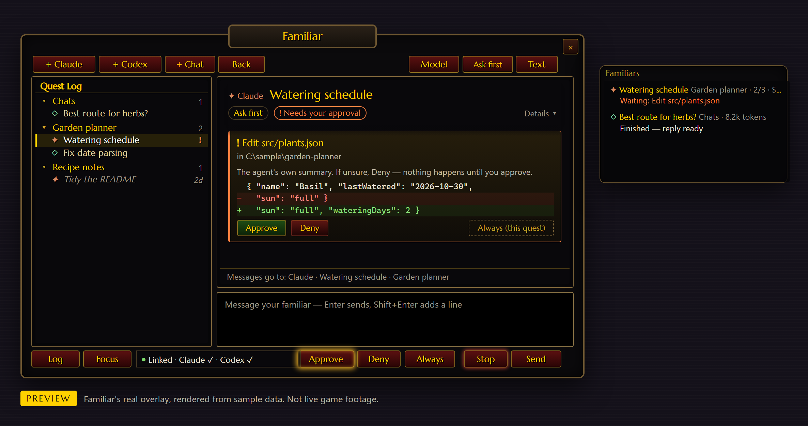
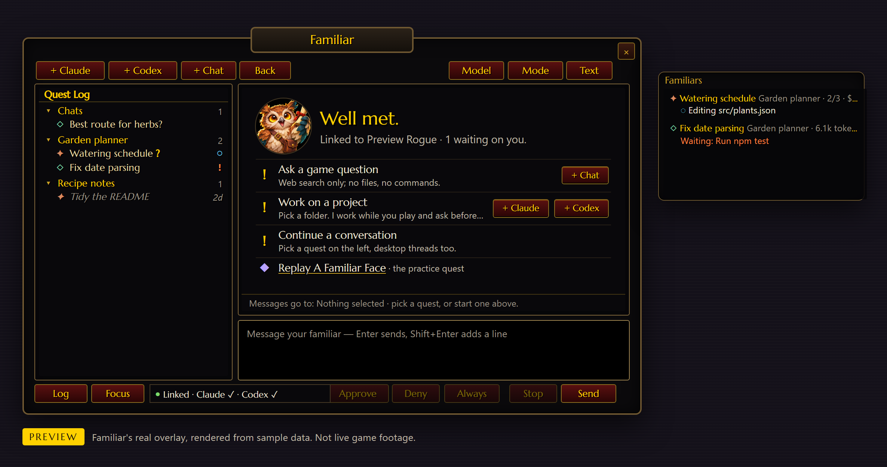
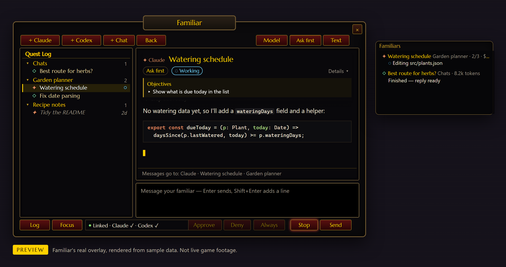
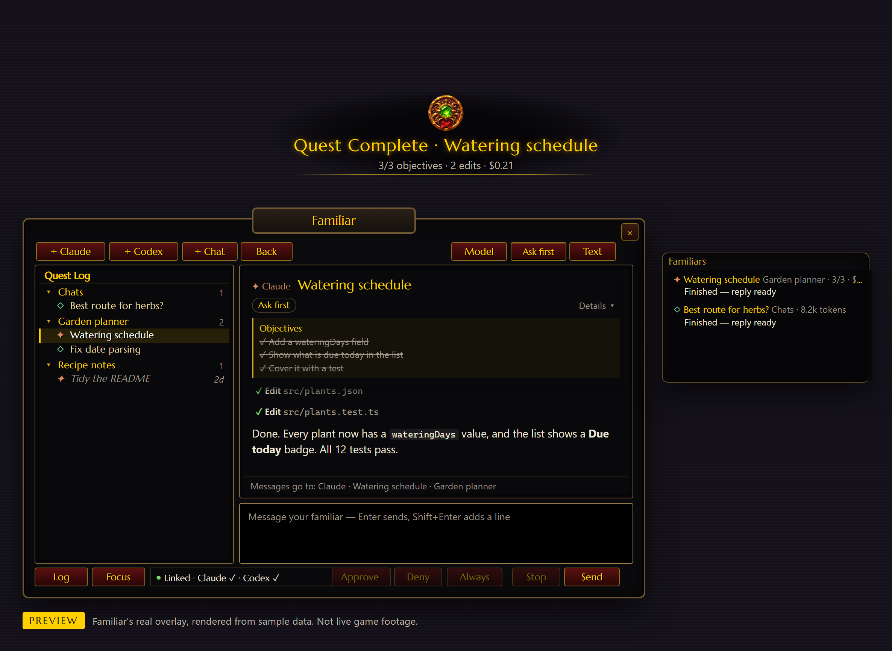
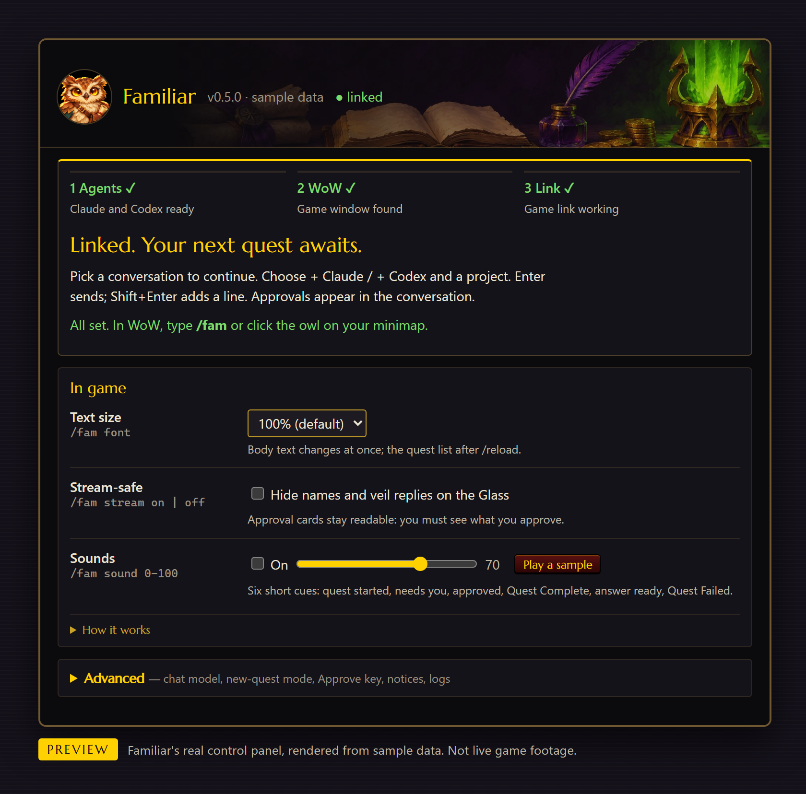
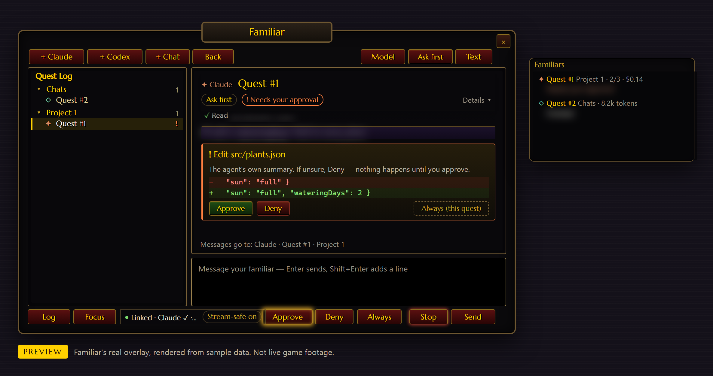

# Familiar

A quest log for your coding agents, inside World of Warcraft: Forever.



*Rendered from the real overlay with sample data.*

## Familiar in one minute


* **What it is:** a quest log for your coding agents, inside WoW: Forever.
* **How you use it:** open it with `/fam` or the minimap owl. Your first run puts a short tutorial
  quest, "A Familiar Face", in the log. Pick a project (a "zone"), type what you want, press Enter.
  The agent works while you play. A **?** means it replied. A **!** means it wants to do something
  and needs your OK: you'll see exactly what, and nothing happens until you click Approve.
* **What you need:** Windows 11, WoW: Forever in windowed mode, and Claude Code or Codex already
  signed in on your PC.
* **What it never does:** press keys or click in the game, read game memory, talk to Blizzard's
  servers, or send anything to the Familiar author.

*Original art for Familiar.*

> **Beta.** This is version 0.5.0, a beta tested on a small number of PCs. Expect rough edges and
> please [report bugs](https://github.com/Zeezy3z/familiar/issues/new/choose).

## Install

If the [latest release](https://github.com/Zeezy3z/familiar/releases/latest) lists
**`Familiar-Setup-<version>.exe`**, run that: it installs Familiar for your user (no administrator
rights) and starts it, then go to step 3. Otherwise use the ZIP:

1. Download **`FamiliarApp-v<version>-windows.zip`** from the
   [Releases page](https://github.com/Zeezy3z/familiar/releases). Right-click it → **Properties** →
   **Unblock**, then extract it so that `Run Familiar.cmd` ends up in `C:\Familiar`.
2. Double-click **`Run Familiar.cmd`**. If Windows says "Windows protected your PC", choose
   **More info → Run anyway**. The first run downloads Claude Code (about 112 MB). Familiar's window
   and a tray icon appear.
3. **Restart World of Warcraft.** At character select open **AddOns**, tick **Familiar** and
   **Familiar Sync**, log in and type `/fam`. The control panel says **Linked**.

That is all most people need. [Setup in detail](#setup-in-detail) says what each step does and
how to run from a git clone; [Troubleshooting](#troubleshooting) covers the usual snags.

## How it works

Familiar lets you talk to your own coding agents — **Claude Code**, **Codex**, and any
[Agent Client Protocol](https://agentclientprotocol.com) agent such as Hermes or Grok Build — from
inside **World of Warcraft: Forever**. Start quests (agent threads) in your project folders, watch
replies stream in, approve edits and commands, and hand threads back to the desktop apps, without
leaving the game and **without automating the game**. It has two parts: an addon that only draws,
and a Windows companion app that only reads the game window's pixels and draws its own
click-through overlay (the **Glass**) on top.

```
WoW addon (Lua)  ── Runestrip pixels ──►  Familiar companion (Electron)  ──►  Claude Agent SDK / Codex app-server
      ▲                                              │
      └────────── Glass: click-through overlay ◄─────┘   (+ native snapshot on /reload)
```

## What it looks like



*Rendered from the real overlay with sample data.*



*Rendered from the real overlay with sample data.*



*Rendered from the real overlay with sample data.*



*Rendered from the real control panel with sample data.*

## Is this for me?

Familiar needs **Claude Code or Codex already installed and signed in** on this PC (a Claude Code
sign-in is enough; an `ANTHROPIC_API_KEY` also works). If you have neither, set one up first.
Familiar never holds your credentials: its **Sign in** button only opens the agent's own login
window (see [Signing in](#signing-in)).

## Requirements

| | |
|---|---|
| OS | Windows 11 (Windows 10, macOS and Linux are not supported) |
| Game | World of Warcraft: Forever installed through Battle.net (client folder `_forever_`), display mode **Windowed** or **Windowed (Fullscreen)** |
| Runtime | Nothing extra for the release download (its first run needs internet to download Claude Code). [Node.js](https://nodejs.org) 24 or newer (LTS) only to run from a git clone |
| Disk | ~355 MB unpacked, ~600 MB after the first run downloads Claude Code; a git clone installs ~800 MB of dependencies |
| Agents | At least one, already installed and signed in: **Claude Code** (signed in, or an `ANTHROPIC_API_KEY`) or **Codex** (desktop app). Optional extras: an ACP agent such as Hermes or Grok Build |

## Safety at a glance

* Nothing is typed or clicked in WoW for you: Familiar only reads the game window's pixels.
* Approvals need your real click or key press on your PC; a message from the game cannot approve.
* **Accept edits** and **Auto** can only be chosen on the desktop, and they let any addon start
  quests that act without asking you. Keep **Ask first**. Details:
  [What can talk to your agents](#what-can-talk-to-your-agents).

## Setup in detail

What the three steps above do, one at a time, and how to run from a git clone. These steps are for
the ZIP or a clone; `Familiar-Setup` does steps 1 and 2 itself. Nothing here is needed on a normal
install.

1. Get the app: download **`FamiliarApp-v<version>-windows.zip`** (for example
   `FamiliarApp-v0.5.0-windows.zip`) from the
   [Releases page](https://github.com/Zeezy3z/familiar/releases) and extract it so that
   `Run Familiar.cmd` ends up in `C:\Familiar`. That ZIP (about 150 MB) is ready to run:
   companion, addon and Electron. No Node.js needed. Its first run downloads Claude Code (about
   112 MB) from npm, the exact version Familiar pins, checked against its published hash.
   Or `git clone https://github.com/Zeezy3z/familiar.git C:\Familiar` (needs Node.js 24, see
   step 2). Not inside OneDrive, a synced folder or a network drive: WoW's AddOns folder is linked
   to this folder. If you downloaded a ZIP, right-click it → **Properties** → **Unblock** before
   extracting (see [Troubleshooting](#troubleshooting) for the SmartScreen warning).

   `Familiar-v<version>-forever.zip` on the same page is the addon alone, for addon managers such
   as WowUp. It does nothing without the app, so most people want the `FamiliarApp` ZIP.
   To check a download, compare
   `Get-FileHash .\FamiliarApp-v0.5.0-windows.zip -Algorithm SHA256` with the line for that file
   in `SHA256SUMS.txt` on the same release page.
2. Double-click **`Run Familiar.cmd`**. Windows may show "Windows protected your PC". That is
   SmartScreen seeing a new file, not a malware verdict: **More info → Run anyway**. From the ZIP,
   Familiar starts in a few seconds (after the Claude Code download on the first run): it goes to
   the system tray and opens its control panel. If that download fails, Familiar starts anyway and
   Claude won't work until it succeeds (Codex and the other agents do): the **Familiars** card says
   what went wrong and has a **Retry** button (running `Run Familiar.cmd` again retries too). From
   a git clone, leave the black window open until the control panel appears: it checks for
   Node.js 24+ (and offers to install it with winget), installs dependencies with `npm ci` (first
   run: a few minutes, about 800 MB) and builds the companion first.
3. The companion finds WoW: Forever — from the running game first, otherwise from `wowRoot` /
   `wowFlavor` in `%APPDATA%\Familiar\config.json` — and links the addon into
   `<WoW>\_forever_\Interface\AddOns\Familiar`, plus a small `FamiliarSync` data addon. If it can't
   find the game, the control panel says so and names those two keys.
4. **Restart World of Warcraft** (it only scans for new addons at start). At character select open
   **AddOns** and tick **Familiar** and **Familiar Sync**. If Familiar is marked out of date, tick
   **Load out of date AddOns**.
5. Set **System → Graphics → Display Mode** to Windowed or Windowed (Fullscreen).
6. In game, type `/fam`. The control panel's status row says **Linked** when the companion sees the
   game.
7. Optional: the control panel's **Projects** card has **Add a project folder…** (one folder
   becomes a zone) and **Add a folder of projects…** (its subfolders become zones). They show up in
   the next `+ Claude` pick without a restart. Without any, zones come from your agents' own
   history. A folder matching `exclude`, or holding a `.nofamiliar` file, is refused.

Familiar does **not** start with Windows unless you turn it on: control panel → Advanced → **Start Familiar
when I sign in to Windows**, or `/fam autostart on` in game.

> **Never played WoW?** Display mode: Esc → Options → System → Graphics → Display Mode →
> Windowed. The **AddOns** button is at the bottom-left of the character-select screen. Enter opens
> chat, where you type `/fam`. `/reload` reloads the interface only (it does not log you out), and
> addons are only re-scanned when the game restarts.

## Using it in game

| | |
|---|---|
| `/fam` or the owl on the minimap | open the Familiar window |
| `+ Claude` / `+ Codex` | pick a zone (project) → type your first message → Enter |
| click a quest | open it; dimmed quests are desktop-app threads — send a message to continue them |
| right-click a zone | start a quest there |
| right-click a quest or dimmed thread | archive it — also in Codex and Hermes; Claude and Grok don't let other apps archive, so those are archived in Familiar only (`/fam unarchive` restores everything) |
| `/fam pin` | pin/unpin the selected desktop thread: listed even when it's old (★) |
| `Continue in Claude app` / `Continue in Codex app` (quest header), `/fam open` | hand the selected quest or desktop thread to the agent's own app, same conversation. One owner at a time: while the app has it open, sending from WoW asks you to close it there and press Retry, or continue as a copy |
| `/fam show claude` · `codex` · `all` | filter the Quest Log by agent |
| `+ Chat` / `/fam ask <question>` | chat without a project (see [Chats](#chats)). `/fam ask` continues your latest chat; `/fam ask new <question>` starts another |
| `Approve` / `Deny` / `Always` | answer the agent's pending request by clicking the card on the Glass, the Approve button, or your Approve keybind. Register that key in the control panel (**Advanced** → **Approve key**, e.g. `F9` or `CTRL-F9`; the panel shows what is registered and warns about keys you also play with) so Familiar can check it was really pressed. `/fam approve` and `/fam always` only remind you of this; `/fam deny` and `/fam stop` work from chat. `Always` also allows that kind of action for the rest of this quest (not other quests); that is how long it lasts with Claude and Codex, while other agents (Hermes, Grok) choose the scope themselves and may remember it longer. Every waiting request is also listed in the control panel (**Requests waiting**), where you can answer it with a real click. A request too long for the card shows **Deny** only; you approve those there ([Approving on your PC](#approving-on-your-pc)). See [What can talk to your agents](#what-can-talk-to-your-agents) |
| `Mode` | switches the quest between **Ask first** and **Plan only**, with a click on the Mode button. **Accept edits** and **Auto** can be chosen only in the desktop control panel (**Advanced** → **New quests start in**); new quests start in Ask first unless you change that. Plan only asks the agent not to change anything: Claude uses its own plan mode, and Codex gets a read-only sandbox plus an instruction. If the agent tries anyway, you still get an approval card |
| `/fam focus game` · `stay` | after Enter/Send, give the keyboard back to WoW (default) or keep typing in Familiar |
| `Model` | open the model list in the details pane; click one to use it |
| `Text` | native, copyable transcript (from the last `/reload`) |
| `Log >>` / `<< Log`, `/fam log` | collapse the quest log so the window is just the quest you're in |
| **Options → AddOns → Familiar**, `/fam opacity 0-100` | window background opacity |
| `/fam <text>` | send to the selected quest without opening the window |
| `/fam claude <text>` / `/fam codex <text>` | start a quest in the current zone |
| `/fam stop` · `tracker` · `strip tr` · `quiet on` · `diag` · `reload` · `help` | stop the agent, toggle the tracker, move the strip, mute ordinary notices, print diagnostics, … |
| `/fam sound on` · `off` · `0-100` | cues on or off, or set their volume (also in the control panel, under **In game** → **Sounds**) |
| `/fam stream on` · `off` | Stream-safe: hide names and blur replies on the Glass (see [Streaming](#streaming)) |
| `/fam private on` · `off` | hide names only: project and quest names (see [Streaming](#streaming)) |
| `/fam draft discard` | clear this character's unfinished composer draft |
| `/fam suggest <idea>` | open a pre-filled GitHub issue in your browser (up to 500 characters; also **Suggest a change** in the control panel). Only your text and version numbers go in; nothing is sent until you submit it there |

Keybindings: *Options → Keybindings → AddOns → Familiar*. In the composer, **Ctrl+Up / Ctrl+Down**
browses sent messages; an unfinished draft survives `/reload` and logout and never sends itself.
Messages sent while the companion isn't running wait in the addon's outbox (newest 20, for a day)
until the companion confirms them at the next `/reload` or login; `/fam resend` / `/fam discard`
handle the rest.

**Which desktop threads are listed:** the ones you'd see in the Claude and Codex desktop apps,
active in the last 21 days (`externalDays`), 6 per zone (`externalPerZone`) then `+N more`; pinned
and running threads always show. Threads archived there are hidden here too
(`followDesktopArchive`); scheduled runs, headless sessions, sub-agents and empty sessions are left
out.

## Chats

Chats live in the **Chats** zone at the top of the Quest Log. They have no project folder: no
files, no commands. Claude chats run Claude Haiku at medium effort with web search only. Codex
chats get web search in a read-only sandbox with Codex's shell, plugins, apps and browser/computer
control switched off; MCP servers from your own Codex `config.toml` still load, and anything Codex
asks permission for comes to you as an approval card. **Model** in a chat picks another model and
effort; the control panel (**Advanced** → **Chat defaults**) sets the default.

Your character's level, race, class, faction and zone, and your quest log with objective progress,
go along with each chat question (never your character name or realm). `/fam ask context off`
stops that.

## More agents

Besides Claude and Codex, Familiar drives any agent that speaks the Agent Client Protocol over
stdio. Hermes (`hermes acp`) and Grok Build (`grok agent stdio`) are picked up automatically when
installed; add others under `providers` in `config.json`, e.g.
`"gemini": { "command": "gemini", "args": ["--experimental-acp"] }` (`"enabled": false` hides one).
They appear in the new-quest picker and work with `/fam <id> <text>` and `/fam show <id>`.

Familiar never selects a mode that skips approvals (yolo / bypass / "don't ask") and strips
`*YOLO*` switches from the agent's environment. An agent that offers only such modes isn't
started; one that switches itself into one is switched back, or stopped. Agents' own bypass
commands (`/always-approve`, `/yolo`, …) are refused when typed in game.

**Hermes:** your Hermes CLI and desktop app conversations are listed, read from Hermes's
`state.db` (read-only). Bot conversations (Telegram, Discord, Slack) are hidden unless
`hermesBotSessions` is true in `config.json`; when shown, their message text (in group chats, other
people's messages too) is read from Hermes's local database like any other session. Hermes can only resume sessions created over ACP, so continuing a
desktop/bot conversation starts a new Hermes session that begins with a summary of it, and replies
come to the game, not back to the chat app. Hermes denies an unanswered approval after 60 s.

## Signing in

Familiar talks to agents you already have installed. It has no accounts, no login of its own and no
servers, and it never reads, copies or stores any agent's credentials. The control panel's
**Familiars** card (under the step strip until your first agent is set up, then under
**Advanced**) shows each agent as installed / signed in, with a **Use** switch, **Install…**
(opens the vendor's page; Familiar never installs agents) and **Sign in**.

**Claude.** The supported path is an Anthropic API key: create one in the
[Claude Console](https://platform.claude.com/), set `ANTHROPIC_API_KEY` for your Windows user
(System → Environment Variables) and restart Familiar; usage is billed to your key. Familiar runs
the unmodified Claude Code binary from the official `@anthropic-ai/claude-agent-sdk` package, which
uses whatever sign-in already exists on your PC, including an existing Claude Code sign-in. Whether
your plan allows that through a third-party tool is governed by
[Anthropic's terms](https://code.claude.com/docs/en/legal-and-compliance) and is your
responsibility. The **Sign in** button only opens a window running the unmodified `claude /login`.

**Codex.** Install and sign in to the Codex desktop app; Familiar uses the `codex.exe` it ships
(see [Troubleshooting](#troubleshooting) if you only have the npm CLI). Usage counts against your
own plan.

**Hermes / Grok / other ACP agents.** Each tool's own login (`hermes setup`, `grok login`, …);
**Sign in** runs it in a window you can see.

## Configuration

`%APPDATA%\Familiar\config.json` (control panel → **Advanced** → **Open config**, then **Reload config**). If a
hand edit leaves it invalid JSON, Familiar moves it to `config.json.bad-<time>` and starts from
defaults.

| Key | Default | What it does |
|---|---|---|
| `projectRoots` | `[]` | folders whose subfolders are offered as zones (zones also come from your agents' history); the control panel's **Projects** card edits this |
| `projects` | `[]` | extra individual project folders (also on the **Projects** card) |
| `exclude` | `node_modules`, `.git`, temp, recycle bin | path fragments never listed or offered; an empty `.nofamiliar` file in a folder does the same |
| `wowRoot` / `wowFlavor` | `C:\Program Files (x86)\World of Warcraft` / auto | where WoW is; set `wowFlavor` to `_forever_` if detection picks the wrong client |
| `defaultMode` / `defaultAgent` | `ask` / `claude` | mode and agent for new quests (also in the control panel) |
| `launchAtLogin` | `false` | start in the tray when you sign in to Windows |
| `claudeExecutable` / `codexExe` | auto | full path to a specific Claude Code / `codex.exe` |
| `providers` | Hermes, Grok | ACP agents (see [More agents](#more-agents)) |
| `hermesBotSessions` | `false` | list Hermes's Telegram/Discord/Slack conversations too (their message text is then read from Hermes's local database) |
| `chatAgent` / `chatModel` / `chatEffort` | `claude` / `haiku` / `medium` | defaults for Chats |
| `externalDays`, `externalPerZone`, `followDesktopArchive` | `21`, `6`, `true` | which desktop threads are listed |
| `sound` / `soundVolume` | `true` / `70` | six short cues (quest started, needs your approval, approved, Quest Complete, answer ready, Quest Failed), made in code; volume 0-100. Also in the control panel and `/fam sound` |
| `speak`, `quiet`, `raidWarnings`, `fontScale`, `toolDetail` | | notices and display |
| `trayNotices` | `true` | a Windows notice when a request is waiting and WoW isn't in front (control panel → **Advanced** → **Notices**) |
| `privateMode` | `false` | Hide names (streaming): generic project/quest names, no desktop threads, generic notices (see [Streaming](#streaming)) |
| `blurTranscript` | `false` | blur replies, sent messages and tool lines on the Glass; set together with `privateMode` by **Stream-safe** (see [Streaming](#streaming)) |

Logs: `%APPDATA%\Familiar\familiar.log` (control panel → **Advanced** → **Open log file**). **Companion controls**
(also under **Advanced**) shows a copyable build line (version, commit, source status; no paths) for bug reports.

## Privacy & data

Familiar has no server. It contains no telemetry, analytics, crash reporting, background update
checks or accounts, and it never sends anything to the Familiar author. Most internet traffic comes
from the coding agents you choose, talking to their own vendors under your own sign-in and their
own privacy terms. Familiar identifies itself to them as a client app (`familiar-wow`).

Familiar itself makes two kinds of network request, and only these:

* **Downloading Claude Code, from the npm registry (`registry.npmjs.org`).** The release download
  doesn't contain Claude Code. When it is missing, or isn't the version Familiar pins, Familiar
  downloads the two packages it needs (about 112 MB) and checks each against a published hash
  before using it. That happens on the first run of `Run Familiar.cmd`, and again whenever Familiar
  starts and finds them missing, including at Windows sign-in if you turned that on. The control
  panel shows the progress and a **Retry** button. The request carries nothing about you beyond what any
  download shows (your IP address and the user agent `familiar-fetch-claude`). A git clone gets
  Claude Code through `npm ci` instead.
* **Check for updates, to GitHub.** Only when you click the button (control panel → **Advanced** →
  **Companion controls**): one request to
  `api.github.com/repos/Zeezy3z/familiar/releases/latest`, with no sign-in and the user agent
  `familiar-wow`. Familiar never checks by itself, and the download page opens in your browser only
  if you then click it.

**Suggest a change** (and `/fam suggest`) opens a pre-filled issue in your browser; nothing is sent
until you submit it there.

* **What each agent receives:** your prompts, plus whatever the agent reads in the project folder
  you started it in. Chats also receive your character's level, race, class, faction, zone and
  quest log (never name or realm); `/fam ask context off` stops that.
* **What Familiar reads on your PC** (read-only, never uploaded): your Claude, Codex and Hermes
  conversation lists and histories, to show and continue them in game (Hermes bot conversations —
  Telegram, Discord, Slack — are hidden unless `hermesBotSessions` is true in `config.json`; when
  shown, their message text is read from Hermes's local database like any other session); whether each agent's sign-in file exists, never its contents; the game
  window's pixels. It never sends input to WoW and never reads game memory.
* **What Familiar stores, all on your PC:**
  * `%APPDATA%\Familiar\` — `config.json`, `threads.json` (copies of Familiar conversations),
    `familiar.log` (diagnostics; may contain folder paths, check before sharing), and
    `strip-<time>.png` pictures, only when you click **Save what Familiar sees** (the top-left
    320×32 pixels of the game window, never the whole screen; look at one before you share it).
  * `%LOCALAPPDATA%\Familiar\claude\` — the downloaded Claude Code, for the installed app. (With the
    ZIP or a clone it is inside the Familiar folder.)
  * `<WoW>\_forever_\Interface\AddOns\FamiliarSync\` — a snapshot of your quest list and the open
    conversation, readable by other addons.
  * WoW SavedVariables (`Familiar.lua`) — the last 30 prompts you sent, in plain text, messages
    awaiting confirmation, settings, and your unsent draft (per character).
  * Conversations you start also live in each agent's own history.

### Streaming



*Rendered from the real overlay with sample data.*

* **Stream-safe (the one switch to use):** control panel → **In game** → **Stream-safe**, or
  `/fam stream on|off` in game. It hides names (see **Hide names only** below), blurs replies, your
  sent messages, tool lines and objectives on the Glass under a dark veil, and turns speech off. Click a blurred reply
  to read it for 8 seconds. **Approval cards are never blurred**: you must see what you approve.
  What you type in the box is still on screen while you type it, and the control panel is a
  separate window on your PC that shows real names and whole requests, so keep it out of the
  captured area. Unticking restores names and text; speech stays off until you turn it on.
* **On stream or in screenshots:** the overlay (project names, titles, replies, approval commands)
  is a separate window, so it is **not** in OBS **Game Capture**. Capture it with **Display
  Capture**, or with a **Window Capture** source on the window titled `Familiar Glass`
  (`electron.exe`; pick the *Windows 10 (1903 and up)* capture method; if it shows black instead
  of see-through, use Display Capture). The small coloured strip at the top-left of the game
  encodes what you are sending; crop it out: it is 256×16 pixels in the game window's top-left
  corner (use a *Crop/Pad* filter on the source), and `/fam strip dim` makes it near-black.
  (The OBS steps are untested across OBS versions.)
* **Hide names only (no blur):** control panel → **Advanced** → **Hide names** (the `/fam private`
  command and `privateMode` config key keep their names), or `/fam private on|off`. Zones show as
  *Project 1, 2, …* and quests as *Quest #1, #2, …* (chats as *Chat #n*), desktop threads are
  hidden, notices and raid warnings are generic (for example `Quest Complete` or `Quest Failed`,
  with no project or quest name; normally they name both, never the reply text), nothing is
  spoken, and the FamiliarSync snapshot holds no titles and no transcript. It hides names, not
  content: replies, tool lines, approval cards and what you type stay visible on screen and can
  contain file names or paths. Your real names and conversations are kept on your PC as before.

## What can talk to your agents

The link from the game to your PC is a strip of pixels that the addon draws and the companion
reads. WoW runs every addon in one shared Lua environment, so **anything that runs Lua in your WoW
client — another addon, a WeakAura or UI-profile import string, a macro — can draw that strip, call
Familiar's slash commands, and send text to your agents as if you had typed it.** No in-game
secret could stop that: every addon sees the same globals. So Familiar never lets a message from
the game *decide* anything on its own:

* **Approvals are matched to your real input.** Approve, Always, option answers, Continue/Retry
  and Mode only count when the companion sees, read-only through Windows, that you released the
  mouse on that button or card, or pressed the Approve key you registered in the control panel,
  within about 1.5 seconds. Each click counts once, and a request must have been on screen for
  0.4 s before it can be approved. A message that merely claims a click is ignored and logged.
  Deny and Stop always work.
* **Budgets and visibility.** From the game Familiar accepts at most 6 new quests and 20 messages
  per 5 minutes, and shows **Started: <quest> (<zone>)** for every new quest. If you see one you
  didn't start, `/fam stop`, then find the addon.
* **Quests start in Ask first.** Everything the agent wants to run or change comes to you as a
  card, shown as the agent reports it, until it is answered. Long edits are cut at 60 lines, plans
  and commands at 4,000 characters and permission lists at 600 characters. A cut request can only
  be denied from the game; see [Approving on your PC](#approving-on-your-pc).
* **Riskier modes only from the desktop.** In game, Mode only switches between Ask first and Plan
  only. **Accept edits** (the agent changes files in its project without a card; Codex: also runs
  sandboxed commands there) and **Auto** (the agent approves routine actions itself) can only be
  chosen in the control panel. If you make one of them the default, any addon in your client can
  start a quest that acts without asking you.
* **No bypass modes.** Nothing in the game or the control panel reaches bypass-permissions /
  danger-full-access / yolo modes.
* **Desktop side.** Settings change only from the control panel window; the overlay and capture
  pages cannot reach them or navigate anywhere. Agent output is rendered through a sanitizer. The
  companion opens no network port (test hooks exist only in developer runs, on 127.0.0.1, with a
  per-run token).

What you should do: install addons and import strings only from sources you trust; keep **New
quests start in** at **Ask first**; register your Approve key if you want to approve from the
keyboard; read each card before you approve it. What Familiar does **not** stop: an addon you
installed that starts quests, sends prompts, denies or stops your agents, or archives threads. It
can do what your keyboard can, short of approving.

**Why did my click or key not approve?** Familiar approves only when it can match the approval to
your mouse or your registered Approve key. If the game stalled or the request had only just
appeared, click again. A keybind approval does nothing until that key is entered in the control
panel. A request the card says is cut is approved only in the control panel (below).

### Approving on your PC

Open Familiar's control panel (tray → **Open Familiar**). The **Requests waiting** card at the top
lists every request your agents are waiting on, each with its whole text in a scrollable box and
then **Approve · Deny · Always (this quest)**. You can answer there or in the game; a request stays
listed while it is pending. Questions with choices to pick from are answered in the game and are
not listed.

Some requests are too long for the in-game card. They are marked **Too long for the in-game
card**. Familiar never offers **Approve** or **Always** for those in the game, even with a real
click: the card says part of the request is not shown and has **Deny** only. You approve those in
the panel.

Only a real click or key press in the panel window counts (a click in the focused panel is physical
input on your PC); nothing in the game, and nothing automatic, can answer from there. The panel
shows real names even when Hide names or Stream-safe is on, because it is on your PC and not part of
the stream.

**Windows notice.** When a request is waiting and WoW isn't in front (or is minimized), Familiar
shows a Windows notice from its tray icon; clicking it opens the panel. With Hide names or
Stream-safe on, it names nothing. Windows quiet hours apply. Untick **Windows notice when a request
is waiting and WoW isn't in front** under **Advanced** → **Notices** to turn it off. It makes no
network request.

## Is this allowed by Blizzard?

Familiar is not affiliated with or endorsed by Blizzard Entertainment, and Blizzard has not
reviewed it. There is no official Blizzard position on tools like it.

* The addon uses only the standard addon API: it draws a small strip of coloured pixels and reads
  your quest log and character info, like any addon.
* The companion only reads the game window's pixels, using the same Windows screen-capture API OBS
  and Discord use, and draws its own separate, click-through window on top.
* Familiar never sends keystrokes, mouse input or window messages to WoW, never reads or modifies
  game memory or files other than its own addon folders, never connects to Blizzard's servers, and
  does not automate any gameplay. It is not a bot: every action in the game is yours.

We believe this is consistent with Blizzard's UI Add-On Development Policy and Terms of Use.
Blizzard reserves the right to change its rules or disable any add-on, and no third-party tool can
guarantee otherwise. Use at your own discretion.

## Troubleshooting

| Symptom | Fix |
|---|---|
| "Windows protected your PC" / "Open File – Security Warning" on `Run Familiar.cmd` | Familiar is new and `Run Familiar.cmd` is not code-signed; this is Windows not having seen the file before, not a malware detection. Only continue if you got it from this repository: **More info → Run anyway**, or unblock the ZIP before extracting (Properties → Unblock). `Run Familiar.cmd` is a plain batch file you can read; `git clone` avoids the prompt. |
| Antivirus quarantines a file, or "This Familiar download is incomplete" | The ZIP holds Electron under `companion\node_modules`, and the first run of `Run Familiar.cmd` downloads the Claude Code binary there (a git clone downloads both on the first run). Restore the file, or extract the whole ZIP again, then run `Run Familiar.cmd` again: it downloads Claude Code again if it is missing. |
| "Running Familiar from a git clone needs Node.js 24 or newer" | Only a git clone needs Node.js; the `FamiliarApp` ZIP does not. Answer **Y** to install the LTS with winget, or install it from nodejs.org, then close the window and run `Run Familiar.cmd` again. |
| Install stops half-way (git clone) | Run `Run Familiar.cmd` again. Last resort: delete `companion\node_modules` and rerun. With the ZIP, extract it again instead. |
| "World of Warcraft was not found" / wrong client | Start WoW: Forever first (Familiar uses the running game's folder), or set `"wowRoot": "D:\\Games\\World of Warcraft"` and `"wowFlavor": "_forever_"` in `config.json`, then **Reload config** and **Reinstall addon**. |
| Retail and Forever both installed | Make sure the addon was linked into `_forever_`, not `_retail_`: start Forever before Familiar, or set `"wowFlavor": "_forever_"`, then **Reinstall addon**. |
| Familiar is "out of date" in the AddOns list | The client is newer than the addon's `## Interface:` list. Tick **Load out of date AddOns**; update Familiar when a release lists the new number. |
| Familiar / Familiar Sync missing from the AddOns list | Restart WoW (not `/reload`). Check that `<WoW>\_forever_\Interface\AddOns\Familiar` exists (`dir` shows `<JUNCTION>`); tray → **Reinstall addon** recreates it and re-points a broken link. |
| **Not linked** although WoW is open | The **Link** step in the control panel says in one sentence what it sees and what to try (WoW minimized, no picture of the window, no coloured strip, a strip it can't read, a window covering the strip). **Advanced** → **Link details** → **Save what Familiar sees** saves a small picture of the top-left corner of the game window; look at it, and attach it to a bug report if you like. If the sentence doesn't help, check, in order: the companion is running (tray icon); Familiar and Familiar Sync are enabled; display mode is Windowed or Windowed (Fullscreen); the game isn't minimized; nothing always-on-top covers the top-left corner (`/fam strip tr` moves the strip top-right); the game stays on one monitor (mixed DPI scaling can misalign after moving it — move or resize once); with Windows HDR on, if the link never locks, turn HDR off for that monitor. The control panel's link details and `/fam diag` show fps and strip geometry. |
| Familiar starts with Windows and you don't want it | Untick **Start Familiar when I sign in to Windows** (control panel → Advanced), or `/fam autostart off`. |
| Claude "Not signed in" | Set `ANTHROPIC_API_KEY` for your Windows user and restart Familiar, or sign in to Claude Code itself (`claude /login`). |
| Claude "Not downloaded yet" or "couldn't be downloaded" | Click **Retry** on the **Familiars** card. The download needs to reach `registry.npmjs.org` (see [Privacy & data](#privacy--data)); a proxy, firewall or antivirus may be blocking it. Codex and the other agents work meanwhile. |
| Codex "Not installed" although the CLI is on your PATH | Familiar finds the npm CLI and winget/scoop installs. If it still says Not installed, run `where codex`. If that prints a `.cmd` under `%APPDATA%\npm`, set `"codexExe"` in `config.json` to the real `codex.exe` inside that folder (below `node_modules\@openai\codex\node_modules\@openai\codex-win32-x64\vendor\...\bin`), then **Reload config**. |

When reporting a bug, include the build line from **Companion controls**, `/fam diag`, and the
`Version` from your WoW folder's `.build.info`; remove personal paths and conversation text.

Ideas and small change requests: `/fam suggest <idea>` in game or **Suggest a change** in the control
panel opens a pre-filled issue (text and versions only) that you review and submit yourself.

## Updating / Uninstalling

**Update:** click **Check for updates** (control panel → **Advanced** → **Companion controls**). It
asks GitHub once whether a newer release exists and links the download page; it never runs by
itself and never downloads or installs anything. Then:

* Installed with `Familiar-Setup`: run the new `Familiar-Setup-<version>.exe` over the old one.
* ZIP or clone: quit Familiar from the tray, extract the new ZIP over the folder (or `git pull`),
  run `Run Familiar.cmd` (after a pull it reinstalls dependencies and rebuilds).

If the release notes say the addon's `.toc` changed, restart WoW; otherwise `/reload` is enough. If
an addon manager updates the addon but not the app (or the other way round), the control panel
header and one notice in game say which is behind.

**Uninstall:**

1. Untick **Start Familiar when I sign in to Windows** (removes the `Familiar` entry under
   `HKCU\…\CurrentVersion\Run`), then quit Familiar from the tray.
2. Delete `<WoW>\_forever_\Interface\AddOns\Familiar` (a link; deleting it deletes nothing else)
   and `…\AddOns\FamiliarSync`.
3. Delete `Familiar.lua` under `<WoW>\_forever_\WTF\Account\<ACCOUNT>\SavedVariables\` and in each
   character's `SavedVariables` folder.
4. Delete `%APPDATA%\Familiar` (settings, logs, saved quests), then the Familiar folder itself.
5. Conversations you started stay in each agent's own history; archive them there if you want
   them gone. Your agents' sign-ins are untouched.
6. If you installed with `Familiar-Setup`, uninstall it from Windows Settings → Apps; that also
   deletes the downloaded Claude Code (`%LOCALAPPDATA%\Familiar\claude`, about 250 MB). If you used
   the ZIP, Claude Code is inside the Familiar folder you delete.

## Development

```bash
cd companion
npm ci --ignore-scripts --no-audit --no-fund
npm run typecheck
npm test                      # codec parity, decoder robustness, headless addon + API conformance
npm run build
scripts/dev-restart.sh --fake # FakeWoW stand-in window + companion with dev hooks (127.0.0.1:47810/47811, per-run token)
```

Read [AGENTS.md](AGENTS.md) and [CONTRIBUTING.md](CONTRIBUTING.md) first. Docs:
[research](docs/research.md), [design](docs/design.md), [protocol](docs/protocol.md),
[roadmap](docs/roadmap.md). Security reports: [SECURITY.md](SECURITY.md).

## License

[MIT](LICENSE). Third-party components: [THIRD_PARTY_NOTICES.md](THIRD_PARTY_NOTICES.md).

Fan project, not affiliated with or endorsed by Blizzard Entertainment, Anthropic or OpenAI.
World of Warcraft is a trademark of Blizzard Entertainment; Claude is a trademark of Anthropic;
Codex is a trademark of OpenAI.
